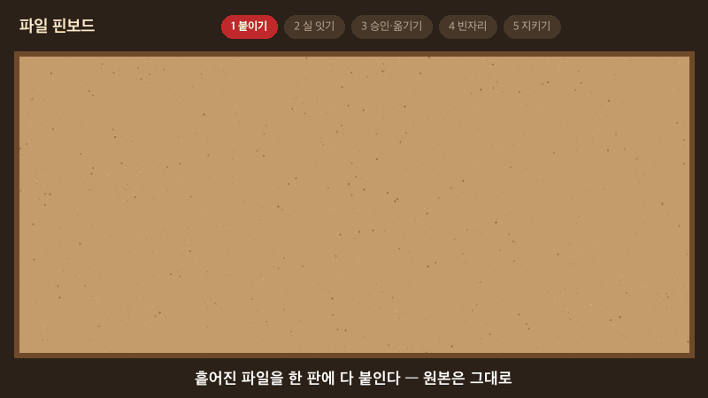
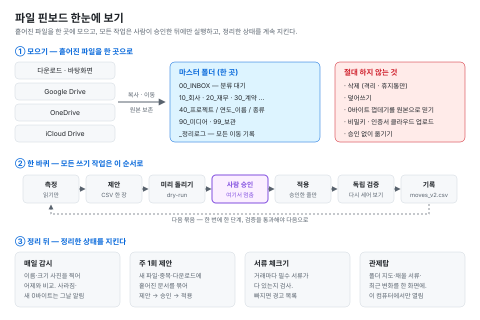
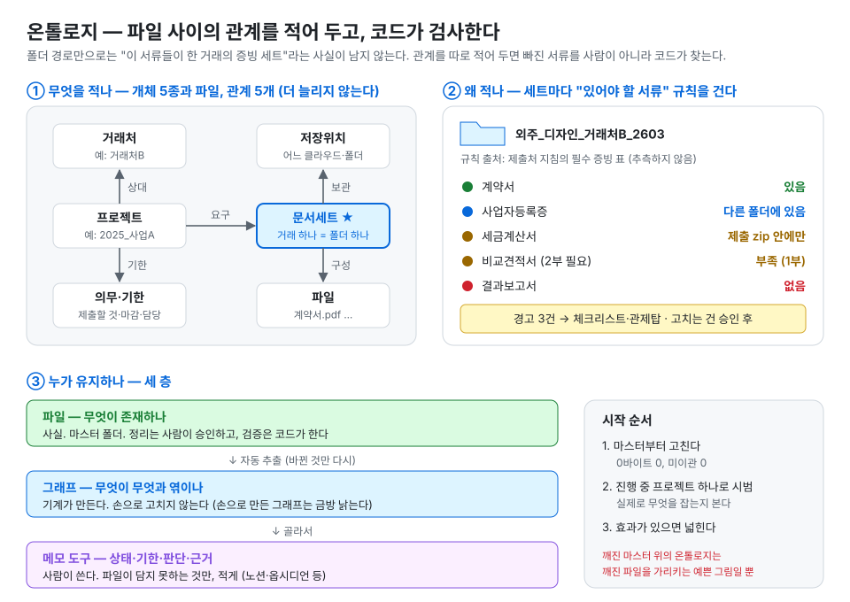
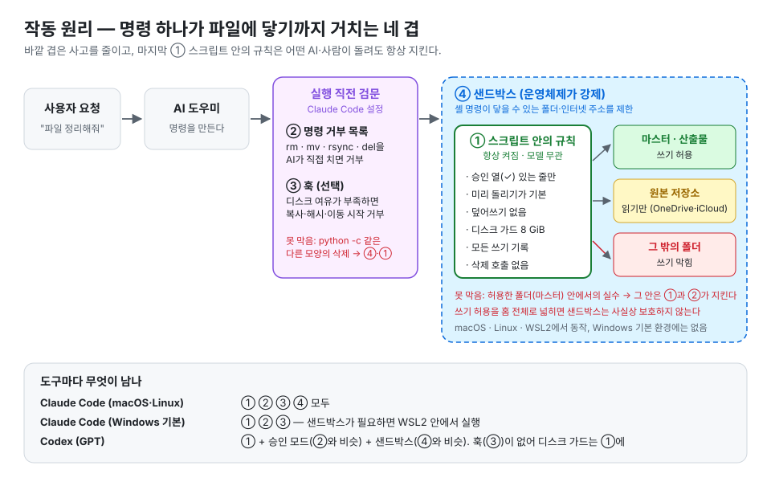

# file-org — 잃지 않고 하는 파일 정리



**흩어진 파일을 한 곳으로, 잃는 것 없이.** AI 도우미(Claude Code · Codex)에게 "파일 정리해줘"라고 하면 이 순서로 일합니다.

| ① 모으기 | ② 승인 | ③ 검사 | ④ 지키기 |
|---|---|---|---|
| 다운로드 · Google Drive · OneDrive · iCloud에 흩어진 파일을 마스터 폴더 한 곳으로. 클라우드 원본은 복사해 보존, 다운로드·바탕화면은 옮김 | 옮길 목록을 먼저 보여 주고, 사람이 ✓한 줄만 실행. 삭제 0 · 덮어쓰기 0 · 모두 기록 | 거래 폴더마다 필수 서류가 다 있는지 코드가 검사해 빠진 것을 알려 줌 | 디스크가 차면 멈췄다가 비우면 이어서. 예약 작업을 걸면 매일 변화를 감시(자동 실행은 따로 설정, 「사용」 참고) |

## 시작하기 — AI 도우미에게 말로

명령어를 몰라도 됩니다. Claude Code나 Codex 같은 AI 도우미에게 차례로 말하세요.

1. **"https://github.com/Noah7601/file-org 스킬 설치해줘"** — 설치하고 자체 검사까지 돌려 결과를 알려 줍니다.
2. **"안전 설정도 해줘"** (선택, Claude Code) — 삭제 명령 거부, 쓰기 범위 제한, 디스크 가드를 실제 경로로 채워 보여 주고, 승인하면 넣습니다.
3. **"파일 정리해줘"** — 아래처럼 진행됩니다.

처음 대화 예시(줄임):

```text
나: 파일 정리해줘. 다운로드랑 구글 드라이브가 엉망이야.
AI: 시작 전에 세 가지만 정할게요.
    1) 모을 곳(마스터): 찾아보니 Google Drive가 ~/Library/CloudStorage/GoogleDrive-…/내 드라이브 에 있습니다.
       그 안에 '업무정리' 폴더를 만들어 모을까요?
    2) 삭제: 기본은 하지 않고, 중복은 격리 폴더에 모아 둡니다. 그대로 갈까요?
    3) 분류: 제가 제안하고 승인받는 방식이 기본입니다.
나: 다 기본으로.
AI: 측정했습니다. 다운로드 312개(1.2 GiB) · Drive 4,051개 · 0바이트 18개 · 같은 내용 중복 41개.
    제안표 1/3(50줄): 보고서.pdf → 40_프로젝트/2025_사업A/보고 …
    미리 돌려 본 결과 이름 충돌 0. 옮길 줄에 ✓를 주세요('전부 승인'도 됩니다).
나: 전부 승인
AI: 옮김 50 · 오류 0 · 다시 세어 봄 50/50 · 기록 50줄. 다음 묶음으로 갈까요?
```

AI는 언제나 **보여 주고 → 승인받고 → 실행하고 → 다시 세어 봅니다.** 지우는 일은 하지 않고, 지울 후보는 목록으로만 알려 줍니다.

<details>
<summary>직접 설치하려면(명령어)</summary>

```bash
# Claude Code
git clone https://github.com/Noah7601/file-org ~/.claude/skills/file-org
python3 ~/.claude/skills/file-org/tests/smoke_test.py
# Codex
git clone https://github.com/Noah7601/file-org ~/.codex/skills/file-org
python3 ~/.codex/skills/file-org/tests/smoke_test.py
```

- 새 맥에서 `git`이나 `python3`을 처음 치면 "개발자 도구 설치" 창이 뜹니다. 설치(몇 분)한 뒤 다시 실행하세요.
- Windows는 `python3` 대신 `py -3`, 경로는 `%USERPROFILE%\.claude\skills\file-org`입니다.
- 마지막 줄에 `결과: PASS … / FAIL 0`이 나오면 준비 끝입니다.

</details>

### 용어 다섯 개

| 말 | 뜻 |
|---|---|
| 마스터 | 모든 파일을 모으는 한 폴더(로컬이든 클라우드든) |
| 미리 돌리기(dry-run) | 실제로 옮기지 않고 결과만 보여 주는 실행. 모든 스크립트의 기본 |
| 격리 | 지우는 대신 `_정리로그/` 아래 폴더로 옮겨 두는 것. 나중에 사람이 지울지 정함 |
| 클라우드 전용 파일 | 이름만 컴퓨터에 있고 내용은 서버에 있는 파일. 열면 내려받아 디스크를 씀 |
| 기록 | 모든 이동·복사를 한 줄씩 적는 `_정리로그/moves_v2.csv`. 무엇이 어디로 갔는지 되짚는 근거 |

---

실제 2개월짜리 정리(저장소 4곳, 2만여 파일)에서 나온 방법과 스크립트입니다. 스크립트는 파이썬 표준 라이브러리만 쓰며 사람이 직접 돌려도 됩니다. macOS에서 검증했고, Windows 11에서는 기본 정리 도구까지 확인했습니다(아래 "알려진 한계"). 쉬운 설명서 한 페이지: [`docs/README.html`](docs/README.html)(받아서 브라우저로 열기).

## 한눈에 보기



### 온톨로지 — 정리가 끝난 뒤

폴더 경로만으로는 "이 서류들이 한 거래의 증빙 세트"라는 사실이 남지 않습니다. 개체 몇 개와 관계를 따로 적어 두고, 세트마다 필수 서류 규칙을 걸어 빠진 서류를 코드가 찾게 합니다(`check_docsets.py`). 자세한 내용은 [`references/ontology.md`](references/ontology.md), 절차는 [`references/docsets.md`](references/docsets.md).



## 구성

```
SKILL.md                 절차 전체(원칙 8가지, 작업 흐름, 보고 형식)
references/cloud-fs.md   Google Drive · OneDrive · iCloud의 함정과 대처 (macOS · Windows)
references/classify.md   분류: 근거 추출 → 신뢰도 → 배치 승인 → 적용
references/log-format.md 로그(moves_v2.csv) 스키마와 검증 루틴
references/docsets.md    정리가 끝난 뒤: 거래 폴더 · 필수 서류 체크기 · 제출 zip · 관제탑
references/ontology.md   그 다음: 관계를 그래프로 다루는 최소 온톨로지
scripts/                 inventory · find_dupes · apply_moves · verify_log · copy_tree · evict_icloud(macOS)
                         check_docsets · extract_zip_only · control_tower(관제탑) · watch(지속 관리)
tests/smoke_test.py      새 환경에서 먼저 돌리는 자체 검사
hooks/                   선택: Claude Code 디스크 가드 훅
docs/README.html         설명서(한 페이지, 그림 포함)
docs/img/                15초 요약 GIF · 한눈에 보기 · 작동 원리 · 온톨로지 그림(SVG)
```

## 설치

Claude Code:

```bash
git clone https://github.com/Noah7601/file-org ~/.claude/skills/file-org
```

Codex는 `~/.codex/skills/file-org`에 같은 내용을 둡니다. 스크립트는 Python 3.8+ 표준 라이브러리만 씁니다(Windows는 `py -3`). iCloud 로컬 사본 축출 도구만 macOS 전용이며 `swiftc -O scripts/evict_icloud.swift -o scripts/evict_icloud`로 빌드합니다.

## 먼저 할 것

```bash
python3 tests/smoke_test.py
```

임시 폴더에 시험 트리를 만들어 스크립트 네 개를 dry-run → apply로 돌리고 61개 항목(NFD 이름, 동명 충돌, 격리, 덮어쓰기 없음, 재개, 디스크 가드, 체크기, zip 보관, 관제탑 보안, 지속 관리)을 검사합니다. `--cloud-dir <OneDrive·iCloud 폴더>`를 주면 실제 동기화 폴더의 클라우드 전용 판정도 읽기 전용(lstat)으로 확인합니다.

## 사용

에이전트에게 "파일 정리해줘", "Drive·OneDrive·iCloud 합쳐줘", "중복 파일 찾아줘"처럼 말하면 스킬이 켜지고, 처음에 세 가지를 묻습니다: 마스터를 어디로 할지, 삭제를 허용할지(기본 불허), 분류를 누가 확정할지(기본: 에이전트 제안, 사용자 승인). 나머지는 측정으로 정합니다. 마스터는 로컬 · Google Drive · OneDrive · iCloud 어디든 됩니다(Google Drive가 가장 자세히 검증됨).

스크립트만 쓰려면:

```bash
python3 scripts/inventory.py <폴더>                                   # 측정(읽기 전용)
python3 scripts/find_dupes.py <폴더> [--quarantine DIR --log LOG --apply --tag "승인 문구"]
python3 scripts/apply_moves.py --root R --proposals CSV --log LOG --preview           # 승인 전: 전체 계획 보기
python3 scripts/apply_moves.py --root R --proposals CSV --log LOG --apply --tag "승인 문구" [--dedupe --quarantine DIR --mkdir]
python3 scripts/verify_log.py --log LOG                                                 # 다시 세어 보기
python3 scripts/copy_tree.py SRC DST [--exclude node_modules .venv] [--min-free 8]
```

전부 dry-run이 기본이고, `--apply`를 붙여야 실제로 씁니다.

**디스크 여유.** 클라우드 이관은 내려받아 올리는 구조라 로컬 디스크가 찹니다(실제로 배치 하나에 약 4 GiB씩). 그래서 `copy_tree`는 시작 전에 복사할 양과 여유를 비교해 모자라면 시작하지 않고(종료 코드 2), 진행 중에도 여유가 기준(기본 8 GiB) 아래로 내려가면 그 자리에서 멈춥니다(종료 코드 3). 공간을 비운 뒤 같은 명령을 다시 돌리면 이어서 복사합니다. `find_dupes`도 해시 계산 중(클라우드 파일은 읽으면 내려받음) 같은 기준으로 멈춥니다. 재는 곳은 이 컴퓨터의 로컬 디스크입니다(클라우드 폴더는 서버 용량을 보고하므로).

정리가 끝난 뒤 증빙 점검과 관제탑:

```bash
python3 scripts/check_docsets.py --root <증빙 폴더> --rules references/docset_rules.example.json --out <보고서 폴더>
python3 scripts/extract_zip_only.py --root <증빙 폴더> --log <moves_v2.csv>        # 제출 zip 안에만 있는 서류(dry-run)
python3 scripts/control_tower.py --root <마스터> --checks <보고서 폴더>           # http://localhost:8765
python3 scripts/watch.py --root <마스터> --state <상태 폴더> --scatter ~/Downloads   # 지속 관리(매일)
```

관제탑은 이 컴퓨터에서만 열리는 보기 전용 화면입니다. 폴더 지도(용량 비례), 사업별 완결·누락, 채워야 할 서류, 최근 기록을 보여 주고, 새로고침 버튼은 폴더를 이름·크기로만 다시 셉니다(본문을 읽지 않아 클라우드 파일을 내려받지 않음). 자세한 절차는 `references/docsets.md`.

## 작동 원리 — 무엇이 무엇을 막나



명령 하나가 파일에 닿기까지 네 겹을 거칩니다. 바깥 겹(②③④)은 Claude Code 설정이라 쓰는 도구에 따라 다르고, 마지막 ①은 어떤 AI·사람이 돌려도 항상 지킵니다. 각 겹은 막는 것과 못 막는 것이 다르므로 겹쳐 씁니다.

| 겹 | 어디서 동작하나 | 막는 것 | 못 막는 것 | Codex에서는 |
|---|---|---|---|---|
| **① 스크립트 안의 규칙** (항상 켜짐) | 파이썬 스크립트 자체 | 승인 안 된 줄 실행, 덮어쓰기, 잘린 파일, 디스크 가득 참(8 GiB 가드), 기록 누락 | AI가 스크립트를 쓰지 않고 직접 명령을 치는 경우 | 그대로 동작 |
| **② 명령 거부 목록** (Claude Code 설정) | AI가 명령을 실행하기 직전 | AI가 `rm`·`mv`·`rsync`·`del`을 직접 치는 것 | `python -c "os.remove(...)"`처럼 다른 모양으로 돌아가는 삭제 | 승인 모드로 비슷하게 |
| **③ 훅** (선택, Claude Code) | 명령 실행 직전에 검사 프로그램이 끼어듦 | 디스크 여유가 부족할 때 복사·해시·이동 스크립트 시작 | 이미 돌고 있는 작업 중간(①이 막음), 사람이 직접 돌릴 때 | 없음 → 그래서 가드를 ①에 넣음 |
| **④ 샌드박스** (Claude Code, 운영체제가 강제) | 셸 명령이 시작된 뒤 운영체제 수준 | 허용한 폴더 밖에 쓰기, 허용 안 된 인터넷 주소로 보내기. ②를 피한 `python -c` 삭제도 허용 폴더 밖이면 막힘 | 허용한 폴더 **안**에서의 실수. 쓰기 허용을 홈 전체로 넓히면 사실상 보호 없음. Claude의 파일 편집 도구(Edit·Write)는 샌드박스 밖이라 권한 규칙으로 따로 막아야 함 | 샌드박스로 비슷하게 |

샌드박스는 macOS(Seatbelt)·Linux·WSL2(bubblewrap)에서 동작하고, Windows 기본 환경에서는 없습니다(WSL2 안에서 실행하면 됩니다).

### 권장 설정 (Claude Code)

정리 작업을 할 때 **산출물 폴더를 작업 폴더로 열고**, 아래를 그 폴더의 `.claude/settings.json`에 넣습니다. `<…>`는 자기 경로로 바꿉니다.

```json
{
  "permissions": {
    "deny": [
      "Bash(rm:*)", "Bash(rmdir:*)", "Bash(rsync:*)", "Bash(mv:*)", "Bash(unlink:*)",
      "Bash(find * -delete:*)", "Bash(del:*)", "Bash(robocopy:*)", "Bash(Remove-Item:*)",
      "Edit(//<원본 OneDrive 절대경로>/**)", "Edit(//<원본 iCloud 절대경로>/**)"
    ]
  },
  "sandbox": {
    "enabled": true,
    "filesystem": {
      "allowWrite": ["<마스터 경로>", "<옮겨 올 로컬 폴더: 다운로드·바탕화면>"],
      "denyWrite": ["<원본 OneDrive 경로>", "<원본 iCloud 경로>"]
    }
  },
  "hooks": {
    "PreToolUse": [
      {"matcher": "Bash", "hooks": [{"type": "command", "command": "python3 ~/.claude/skills/file-org/hooks/disk_guard_hook.py"}]}
    ]
  }
}
```

- **쓰기 허용**은 작업 폴더(산출물, 기본으로 허용됨)와 마스터, 그리고 파일을 **옮겨 올** 로컬 폴더(다운로드·바탕화면)뿐입니다. 옮기면 원래 자리에서 빠지므로 그 폴더도 쓰기가 필요합니다. 복사만 하는 클라우드 원본은 `denyWrite`로 막습니다.
- **훅 경로**는 설치 위치에 맞춥니다(Codex 설치면 `~/.codex/skills/…`, Windows면 `%USERPROFILE%\.claude\skills\…`). "안전 설정도 해줘"라고 하면 AI가 실제 경로로 채워 보여 줍니다.
- **인터넷 주소 허용 목록은 비워 둡니다.** 이 스킬은 네트워크가 필요 없습니다. 비워 두면 파일이 밖으로 나가는 길도 막힙니다.
- **`Edit(//…)` 규칙**은 Claude의 파일 편집 도구용입니다. 편집 도구는 샌드박스 밖에서 돌아 권한 규칙만 따르기 때문입니다. 권한 규칙의 절대 경로는 `//`로 시작하고, 샌드박스 경로는 `/`나 `~/`로 씁니다.
- 키 이름은 Claude Code 문서(sandboxing, settings)의 2026-11 기준입니다. 정리가 끝나면 이 설정을 지워도 됩니다.

## 안전하게 쓰기

스크립트에는 삭제 호출이 없습니다(자기 임시 파일 `.part` 정리뿐). 이동은 같은 볼륨 안 rename이고 목적지에 파일이 있으면 건너뜁니다. 복사는 `.part`에 쓴 뒤 이름을 바꾸므로 잘린 파일이 남지 않고, 목적지의 다른 파일은 덮어쓰지 않고 충돌로 보고합니다. 모든 쓰기는 `moves_v2.csv`에 남습니다.

남는 위험은 에이전트가 스크립트 밖에서 `rm`·`rsync --delete`·`mv`를 직접 치는 경우입니다. 스킬 문서는 금지하지만 강제하지는 못하므로, 프로그램 쪽에서 두 겹으로 막아 두기를 권합니다.

**1겹 — 삭제·이동 명령 거부.** 정리 작업을 하는 폴더의 `.claude/settings.json`(또는 `~/.claude/settings.json`)에 넣습니다. 이 명령들은 에이전트가 실행하려 해도 거부됩니다. 스크립트(`python3 …`)는 그대로 돌아갑니다.

```json
{
  "permissions": {
    "deny": [
      "Bash(rm:*)", "Bash(rmdir:*)", "Bash(rsync:*)", "Bash(mv:*)", "Bash(unlink:*)",
      "Bash(find * -delete:*)", "Bash(del:*)", "Bash(robocopy:*)", "Bash(Remove-Item:*)"
    ]
  }
}
```

**2겹 — 쓰기 범위 제한.** Claude Code의 샌드박스(`"sandbox": {"enabled": true}` 또는 `/sandbox` 명령)를 켜면 셸 명령이 작업 폴더와 `sandbox.filesystem.allowWrite`에 적은 곳 밖에 쓰지 못합니다. 마스터만 허용하고 원본 저장소는 `denyWrite`로 막습니다. 전체 설정 예는 위 「권장 설정」.

이렇게 두면 삭제가 필요한 단계(격리 폴더 비우기, 스텁 제거)는 자연히 에이전트가 목록을 보고하고 사용자가 Finder·탐색기·웹에서 직접 하게 됩니다. 정리가 끝나면 거부 목록을 지워도 됩니다.

**3겹(선택) — 디스크 가드 훅.** 스크립트 안의 가드가 기본이고, Claude Code에서는 시작 전 한 번 더 막는 훅을 붙일 수 있습니다. 여유가 기준 아래면 복사·해시·이동 스크립트를 실행 전에 거부하고 그 이유를 에이전트에게 알려 줍니다.

```json
{
  "hooks": {
    "PreToolUse": [
      {"matcher": "Bash", "hooks": [{"type": "command", "command": "python3 ~/.claude/skills/file-org/hooks/disk_guard_hook.py"}]}
    ]
  }
}
```

기준은 환경 변수 `FILEORG_MIN_FREE_GIB`로 바꿉니다(기본 8).

### Codex(GPT)에서 쓸 때

스크립트와 SKILL.md는 모델과 관계없이 같습니다(`~/.codex/skills/file-org`에 두면 Codex가 읽습니다). 다른 것은 안전장치를 거는 곳입니다. 위의 거부 목록·훅은 Claude Code 설정이라 Codex에는 적용되지 않습니다.

- `~/.codex/config.toml`에서 명령 승인을 켜고(`approval_policy = "on-request"` 또는 `"untrusted"`), 쓰기를 작업 폴더로 제한합니다(`sandbox_mode = "workspace-write"`). 작업 폴더는 산출물 폴더로 엽니다. 키 이름은 이 글을 쓸 때 기준이니 Codex 문서에서 최신 이름을 확인하세요.
- 디스크 가드는 스크립트 안에 있으므로 Codex에서도 그대로 동작합니다.
- 매일 감시·주간 제안 같은 예약 실행은 각 도구의 예약 기능이나 OS 예약 작업(macOS `launchd`·`cron`, Windows 작업 스케줄러)으로 붙입니다. 무인 실행은 "성공" 표시가 아니라 산출물로 확인합니다(`references/docsets.md` 6절).

## 알려진 한계

- Google Drive for desktop(Windows)은 클라우드 전용 파일을 속성으로 구분할 수 없어 "읽으면 내려받는다"로 가정합니다.
- 마스터를 OneDrive·iCloud로 둘 때의 업로드 확인 요령은 아직 Drive만큼 자세하지 않습니다.
- iCloud for Windows는 미검증입니다.
- Windows 11에서는 2026-11-13 판의 자체 검사 28개(측정·중복·적용·복사·클라우드 판정·긴 경로·휴지통)만 통과를 확인했습니다. 그 뒤에 더한 체크기·zip 낱개 보관·관제탑·감시·디스크 가드는 Windows에서 아직 돌려 보지 않았습니다. 특히 관제탑의 새로고침 명령(셸 따옴표)과 "탐색기에서 보기"(한글·공백 경로), 바탕화면이 OneDrive 안(`OneDrive\바탕 화면`)에 있는 경우의 감시 경로를 확인해야 합니다.

## 라이선스

MIT — `LICENSE` 참고.
